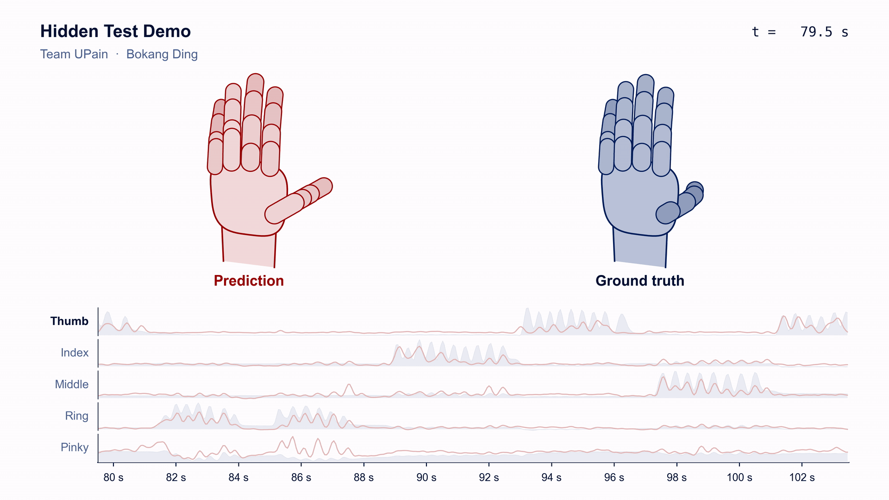
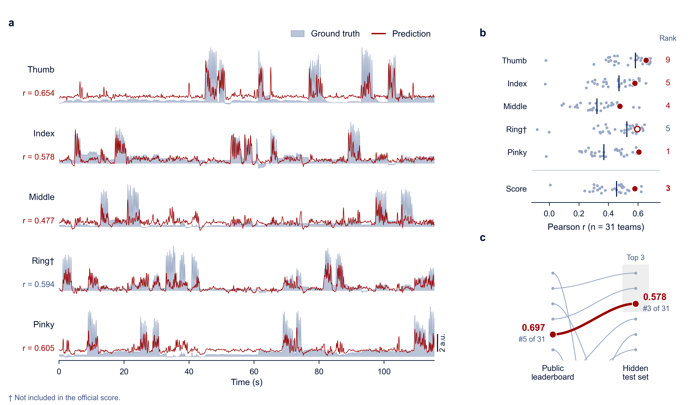

# ECoG Finger Decoding

### [BE 5210 - Brain-Computer Interfaces](https://be5210.com/) &nbsp;·&nbsp; University of Pennsylvania

**Bokang Ding** &nbsp;·&nbsp; Team UPain (Solo)

This project predicts the continuous flexion of all five fingers from ECoG recorded in three subjects (BCI Competition IV dataset 4), with a data glove providing the ground truth. A separate neural network is trained for each subject on spectral features of the signal, with models selected by Pearson correlation on validation data interleaved across the recording. Predictions from three training runs are averaged and realigned to account for the delay between brain activity and movement. In the BE 5210 course competition it placed **🥉 3rd of 31 teams** on the hidden test set, with the **best pinky-finger decoding in the class**.

<p align="center">
  
  <br>
  <sub>Hidden test set, 79.5–103.5 s.</sub>
</p>

## Results

Competition details and full standings can be found on the [course site](https://be5210.com/).

| | Public leaderboard | Hidden test set |
| :-- | :-: | :-: |
| **Score (mean r)** | 0.697 | **0.578** |
| **Rank (of 31)** | #5 | **#3** 🥉 |

<p align="center">
  
  <br>
  <b>Fig. 1.</b> Hidden test set. <b>a</b>, Ground truth and prediction for each finger. <b>b</b>, Per-finger correlation against all 31 teams (tick: class median), with our rank. <b>c</b>, Score and rank from the public leaderboard to the hidden test set.
</p>

## Pipeline

The data come from [BCI Competition IV dataset 4](https://www.bbci.de/competition/iv/): three subjects with `62`, `48`, and `64` ECoG electrodes and a data glove, both sampled at `1 kHz`.

- **Features** ([`preprocessing.py`](ecog_finger_decoder/preprocessing.py)). ECoG is re-referenced to the common median, band-passed to `40-300 Hz` with `60 Hz` notches, and converted to Morlet wavelet power at `100 Hz`. Each frame is paired with the finger position `200 ms` later, since cortical activity leads movement.
- **Model** ([`model.py`](ecog_finger_decoder/model.py)). A 1D convolutional U-Net maps `2.56 s` feature windows to the five finger trajectories. Electrode counts differ across subjects, so each subject gets its own models, trained with three seeds.
- **Inference** ([`inference.py`](ecog_finger_decoder/inference.py)). Each model predicts the whole recording at once; the predictions are averaged over seeds, shifted `200 ms` later to undo the lead, and upsampled to `1 kHz`.

## Quickstart

Requires **Python 3.12+**:

```bash
git clone https://github.com/bkding/ecog-finger-decoder.git
cd ecog-finger-decoder
python3 -m venv .venv
source .venv/bin/activate        # Windows: .venv\Scripts\activate
pip install -e .
```

The scripts read the course's `.mat` files, which are distributed to enrolled BE 5210 students and not included here. To use the public release instead, register and download [BCI Competition IV dataset 4](https://www.bbci.de/competition/iv/), place `sub1_comp.mat` to `sub3_comp.mat` in `data/`, and switch to the BCI IV paths commented out in [`config.py`](ecog_finger_decoder/config.py).

**Preprocessing** (Morlet spectrograms, cached in `data/cache/`):

```bash
python scripts/preprocess.py
```

**Training** (3 seeds × 3 subjects; about 2.75 h on one NVIDIA L4):

```bash
python scripts/train.py
```

**Prediction** (writes `predicted_dg.mat`; set `TEST_MAT` and `TEST_KEY` in [`config.py`](ecog_finger_decoder/config.py) for another recording):

```bash
python scripts/predict.py
```

## Code Structure

```text
.
├── ecog_finger_decoder              # Decoding pipeline
│   ├── config.py                    #   Paths, data files & shared constants
│   ├── preprocessing.py             #   Re-referencing, filtering & Morlet spectrograms
│   ├── data.py                      #   .mat loading, scaling, interleaved split & windows
│   ├── model.py                     #   1D U-Net
│   ├── training.py                  #   Lightning training step & validation Pearson r
│   └── inference.py                 #   Whole-recording prediction, delay shift & upsampling
├── scripts
│   ├── preprocess.py                # Raw recordings to cached spectrograms
│   ├── train.py                     # Seed × subject training runs
│   └── predict.py                   # Seed-ensemble predictions
├── assets                           # README figures
└── pyproject.toml
```

## Acknowledgements

Developed individually for the BE 5210 final project; the model and preprocessing build on FingerFlex. The competition and data were provided by the **BE 5210** course staff at the University of Pennsylvania.

> **Note for Penn Students:** Published as a portfolio artifact. If you are enrolled in BE 5210, please do not copy code from this repository.
